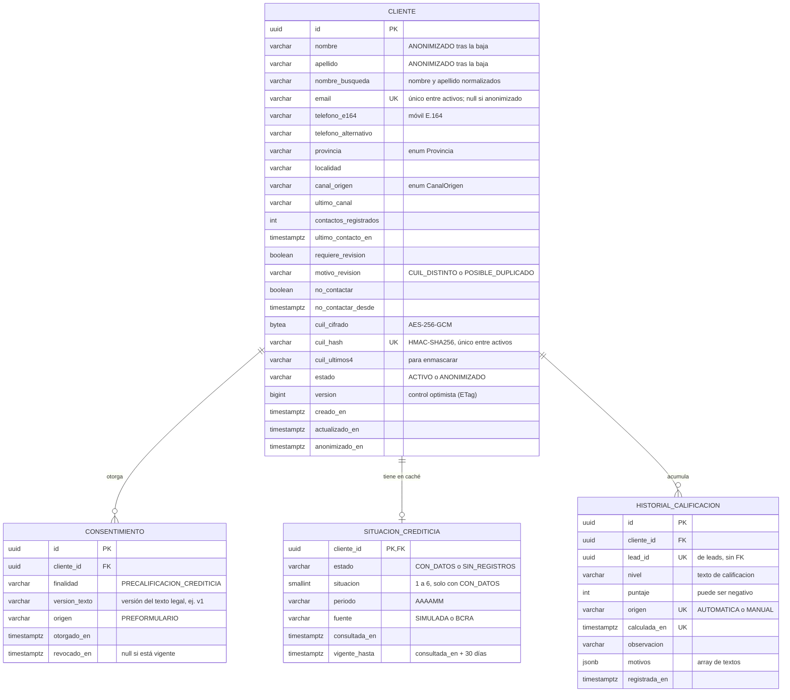

# Diagrama entidad-relación

Base `clientes_db` (PostgreSQL 16), tal como la dejan las migraciones Flyway `V1` a `V5`
(`clientes-service/src/main/resources/db/migration`). Cada servicio es dueño de su base: `lead_id` referencia a un
lead de `leads` por ID, sin clave foránea.

> En `HISTORIAL_CALIFICACION`, la marca `UK` de `lead_id`, `origen` y `calculada_en` indica que las tres columnas
> forman **juntas** la clave única `uk_historial_calificacion`, que hace idempotente el consumo de `lead-calificado`.
> Mermaid no permite marcar claves compuestas, por eso se aclara aquí.

## Restricciones e índices

| Tabla | Restricción / índice | Qué garantiza |
| --- | --- | --- |
| `cliente` | `ux_cliente_email_activo` (único, parcial `estado = 'ACTIVO'`) | Un email pertenece a un solo cliente activo; tras anonimizar queda libre |
| `cliente` | `ux_cliente_cuil_activo` (único sobre `cuil_hash`, parcial) | Un CUIL pertenece a un solo cliente activo, sin descifrarlo |
| `cliente` | `ix_cliente_telefono_activo`, `ix_cliente_provincia`, `ix_cliente_ultimo_contacto` (parciales) | Búsquedas sobre activos |
| `cliente` | `ck_cliente_activo_con_email` | Un cliente activo siempre tiene email |
| `cliente` | `ck_cliente_no_contactar_fecha` | `no_contactar` y `no_contactar_desde` van juntos |
| `cliente` | `ck_cliente_cuil_completo` | Las tres columnas del CUIL van todas o ninguna |
| `cliente` | `ck_cliente_anonimizado_sin_datos` | Un anonimizado no conserva email, teléfonos, localidad ni CUIL |
| `consentimiento` | `ux_consentimiento_vigente` (único `cliente_id, finalidad` donde `revocado_en IS NULL`) | Un solo consentimiento vigente por finalidad |
| `situacion_crediticia` | `ck_situacion_estado`, `ck_situacion_valor`, `ck_situacion_periodo` | Solo se cachean resultados de la fuente; `situacion` 1–6 solo con `CON_DATOS` |
| `historial_calificacion` | `uk_historial_calificacion (lead_id, origen, calculada_en)` | Idempotencia del consumidor |
| `historial_calificacion` | `ck_historial_motivos` | `motivos` es un array JSON |
| `historial_calificacion` | `ix_historial_cliente (cliente_id, calculada_en DESC)` | `GET /clientes/{id}/historial` |
