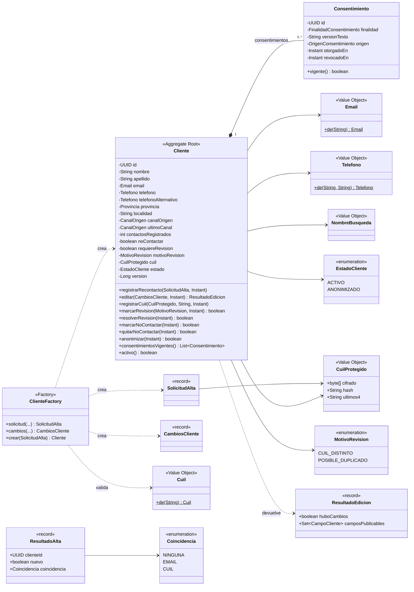
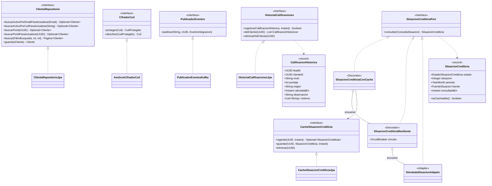
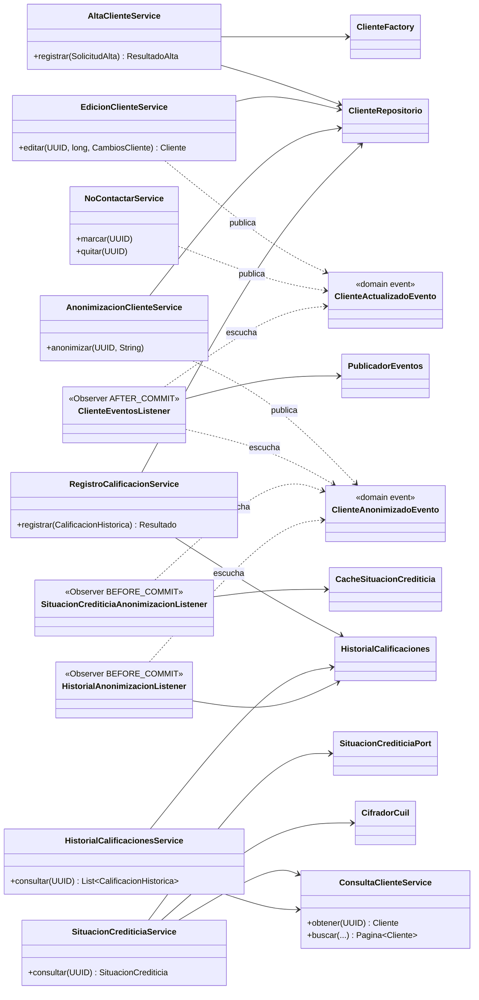
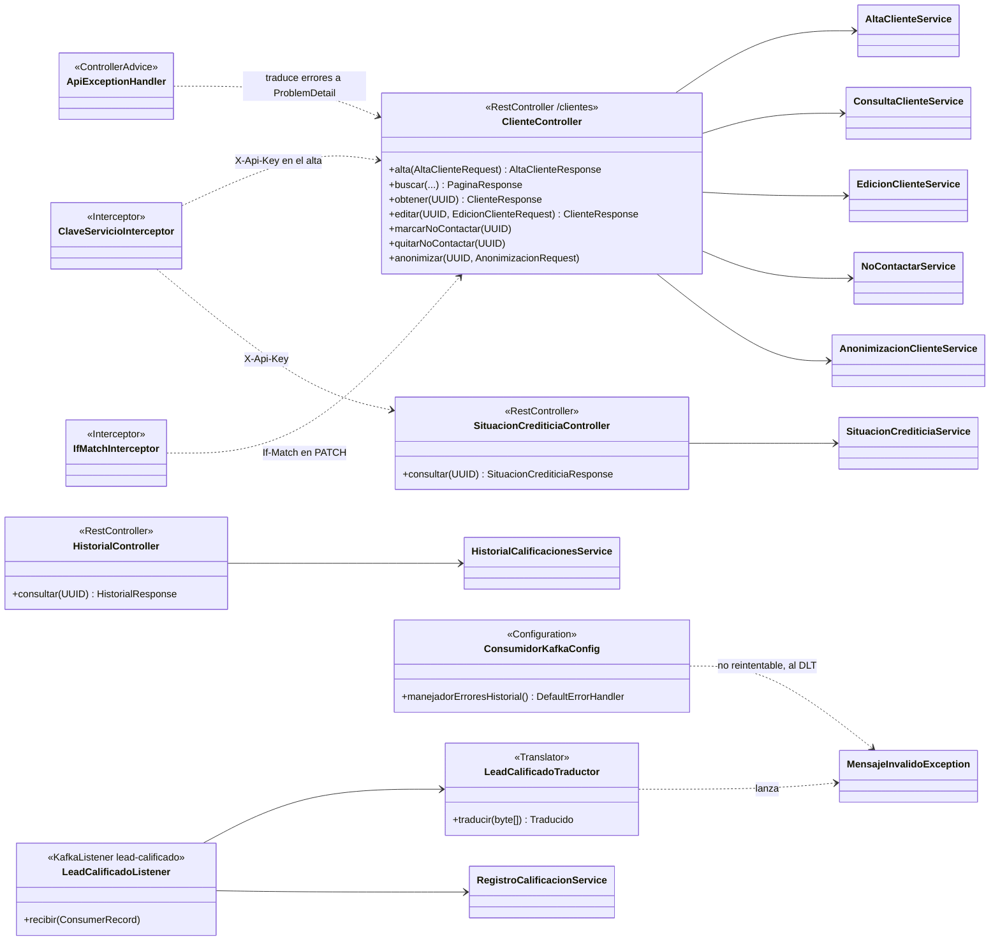

# Diagrama de clases

El servicio sigue una arquitectura hexagonal: `api → application → domain ← infrastructure`. El dominio define
**puertos** (interfaces) y la infraestructura los implementa. Para que se lea, el diagrama está partido en cuatro
vistas. Se muestran las clases y los métodos principales, no todos los getters.

## 1. Dominio: agregado `Cliente` y value objects

## 2. Puertos del dominio y sus adaptadores

La cadena del puerto de situación crediticia es **Caché → Resiliencia → Fuente**. La arma `PrecalificacionConfig`
según `clientes.situacion-crediticia.modo`. En la Segunda Parte, `SimuladaSituacionAdapter` se reemplaza por el
adaptador SOAP del BCRA sin tocar los decorators.

## 3. Aplicación: casos de uso y listeners

## 4. Entradas: API REST y consumidor de Kafka

