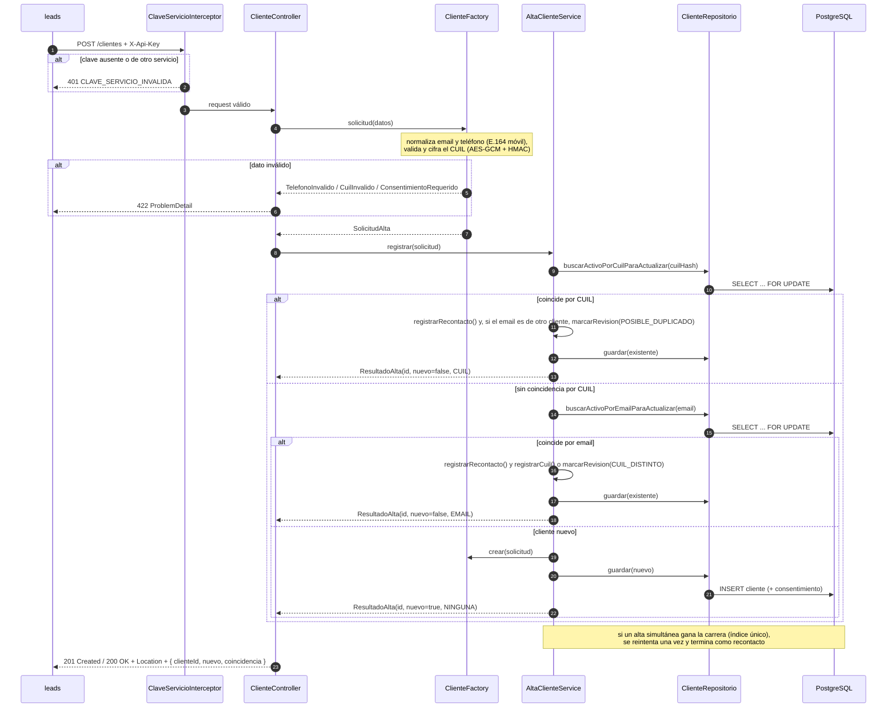
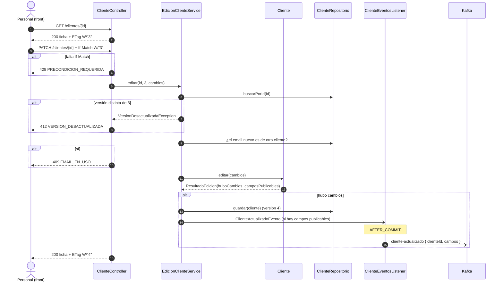
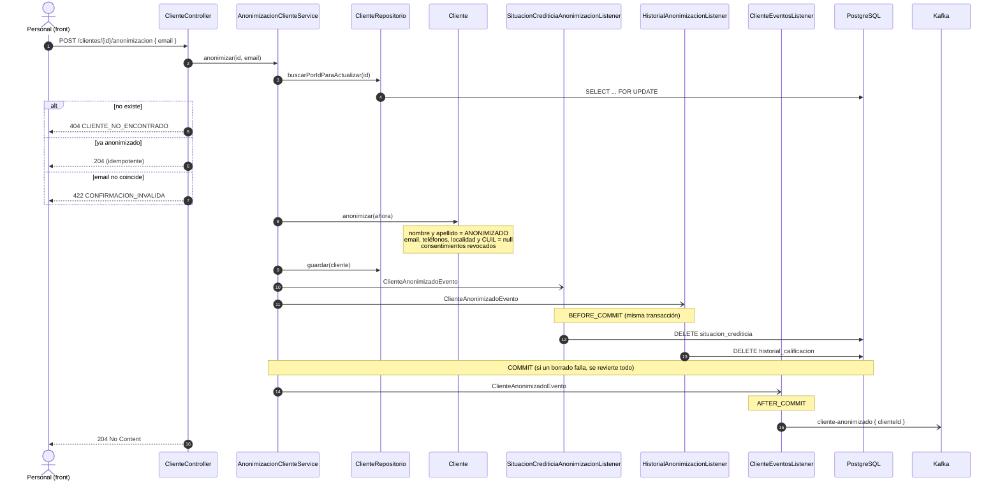
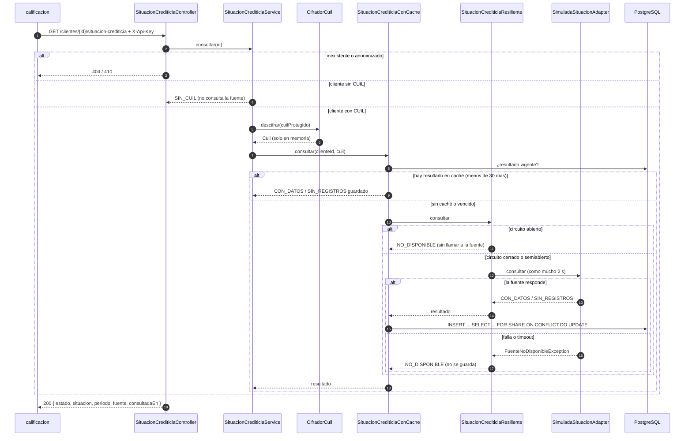
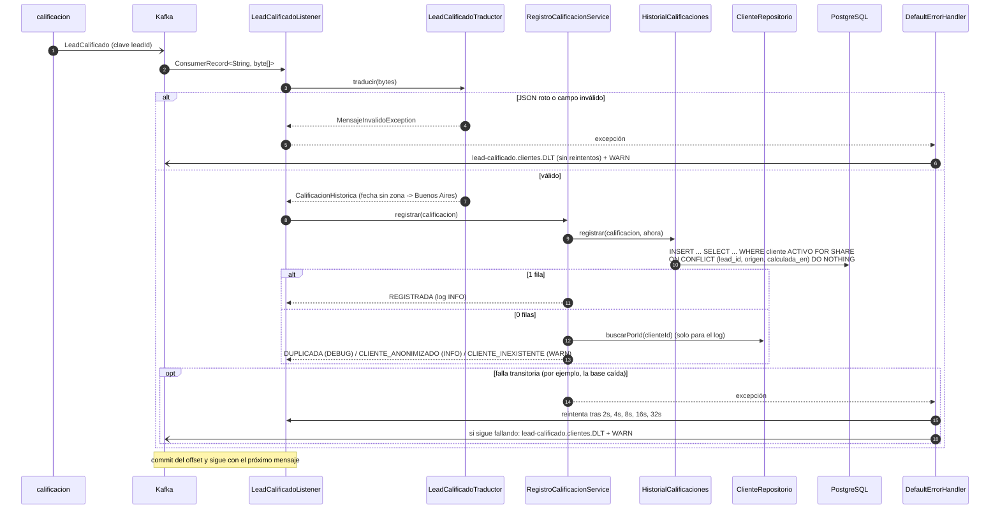
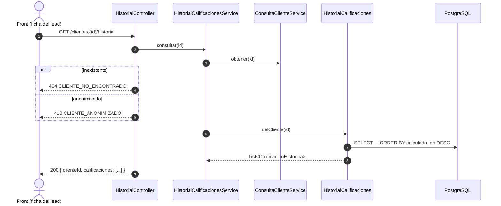

# Diagramas de secuencia

Los flujos principales del servicio, de la entrada (REST o Kafka) a la base y los eventos.

1. [Alta de cliente con deduplicación](#1-alta-de-cliente-con-deduplicación)
2. [Edición con control de concurrencia](#2-edición-con-control-de-concurrencia)
3. [Anonimización](#3-anonimización)
4. [Consulta de la situación crediticia](#4-consulta-de-la-situación-crediticia)
5. [Registro de una calificación (consumo de `lead-calificado`)](#5-registro-de-una-calificación-consumo-de-lead-calificado)
6. [Consulta del historial de calificaciones](#6-consulta-del-historial-de-calificaciones)

## 1. Alta de cliente con deduplicación

`leads` da de alta al cliente cuando se completa el preformulario. Si la persona ya existía (por CUIL o por email),
no se crea otra ficha.

## 2. Edición con control de concurrencia

## 3. Anonimización

Todo ocurre en una transacción. Los módulos que guardan datos del cliente fuera del agregado reaccionan al evento de
dominio antes del commit.

## 4. Consulta de la situación crediticia

## 5. Registro de una calificación (consumo de `lead-calificado`)

## 6. Consulta del historial de calificaciones

