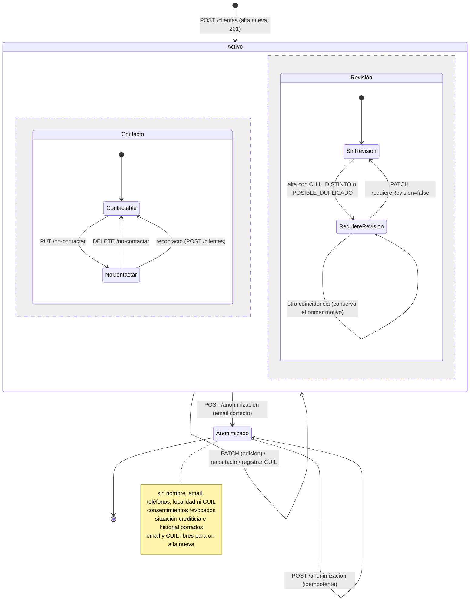
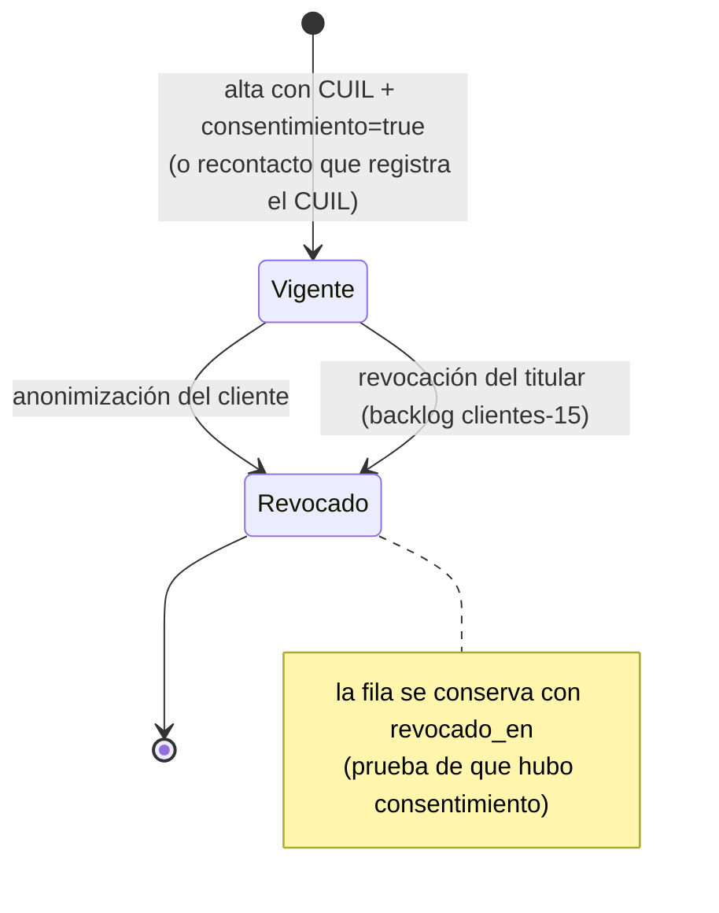
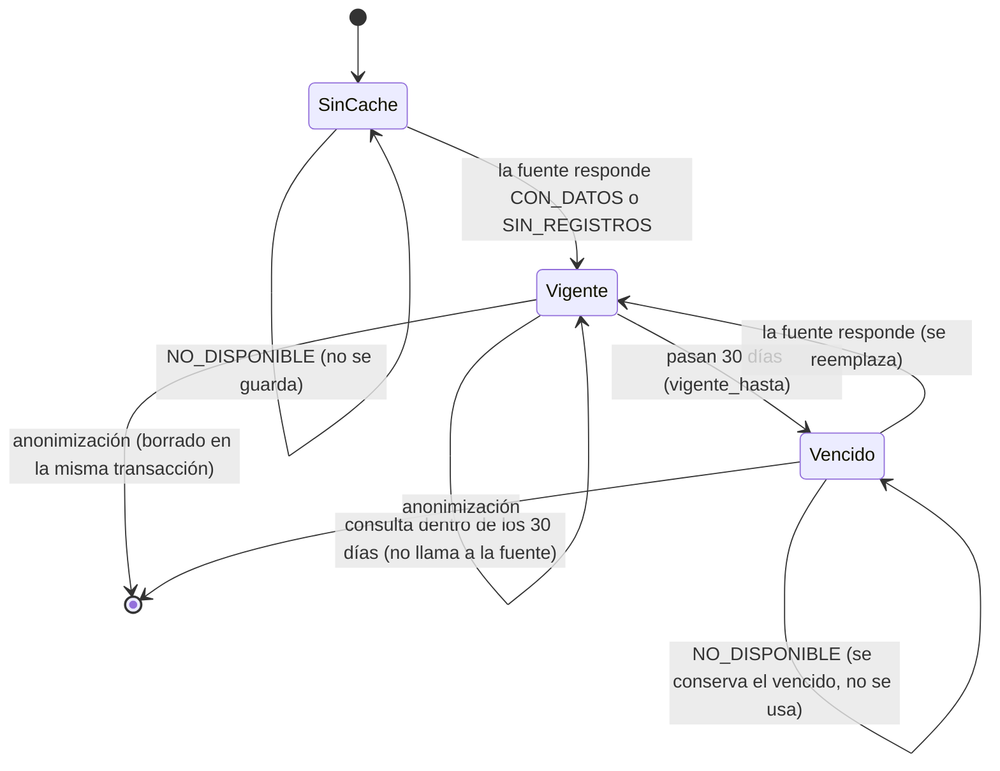
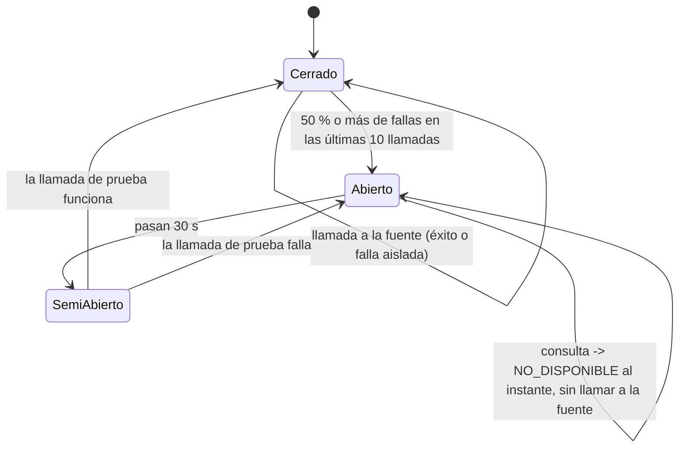
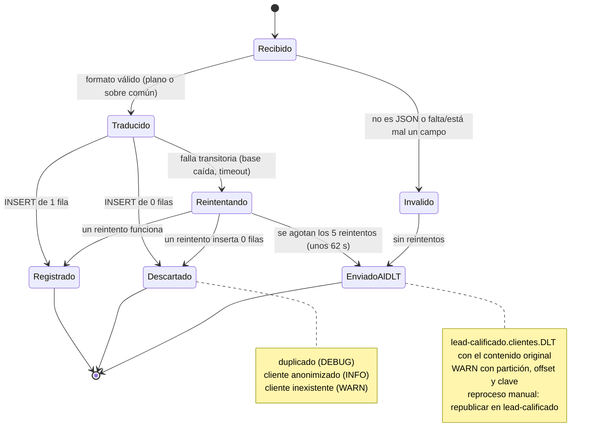

# Diagramas de estados

1. [Cliente](#1-cliente)
2. [Consentimiento](#2-consentimiento)
3. [Situación crediticia (caché y circuit breaker)](#3-situación-crediticia-caché-y-circuit-breaker)
4. [Mensaje de `lead-calificado`](#4-mensaje-de-lead-calificado)

## 1. Cliente

El estado persistido es `ACTIVO` o `ANONIMIZADO`. Mientras está activo, el cliente tiene además dos marcas
independientes: "no contactar" y "requiere revisión". La anonimización es **irreversible**: un cliente anonimizado no
admite ninguna otra operación (`410 CLIENTE_ANONIMIZADO`).

## 2. Consentimiento

Un cliente con CUIL siempre tiene vigente el consentimiento de `PRECALIFICACION_CREDITICIA`; los dos llegan juntos en
el alta. Hoy solo la anonimización lo revoca. La revocación a pedido del titular está en el backlog (`clientes-15`).

## 3. Situación crediticia (caché y circuit breaker)

### 3.1 Resultado guardado por cliente

### 3.2 Circuit breaker de la fuente (Resilience4j, instancia `situacionCrediticia`)

## 4. Mensaje de `lead-calificado`

Ciclo de vida de cada mensaje que consume el historial de calificaciones. En todos los estados finales se confirma el
offset y el consumidor sigue con el mensaje siguiente.

